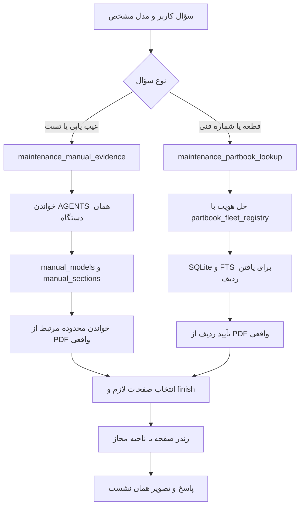

# ممیزی آماده‌سازی منابع ROC-L8 و نقشهٔ تکمیل

تاریخ: 2026-11-15، منطقهٔ زمانی Asia/Tehran  
وضعیت: ممیزی انجام شده؛ پیاده‌سازی و فعال‌سازی انجام نشده است.

## ۱. نتیجهٔ اصلی

هر پنج PDF داخل `ROC-L8` ارزش نگهداری دارند. برای حذف هیچ‌یک از سه فایل تکمیلی مدرک کافی پیدا نشد؛ برعکس، تفاوت نسخه، کاربرد یا مدل در آن‌ها دیده شد. دو فایل تعیین‌شدهٔ شما همچنان منابع اصلی پیشنهادی هستند، اما نوع واقعی سند و محدودهٔ کاربرد باید در سامانه ثبت شود.

این دستگاه با کپی‌کردن AGENTS و فهرست PC800 کامل نمی‌شود. چهار کار اصلی لازم دارد:

1. شناسنامه و قواعد مستقل Atlas Copco، با جداسازی ROC L8 از نسخه‌های دیگر داخل اسناد.
2. فهرست موضوعی برای مجموعهٔ آموزشی و فهرست تصویری برای نقشه‌های بدون متن.
3. استخراج‌گر پارت‌بوک متناسب با قالب Atlas Copco و دو شناسهٔ مستقل برای دو کاتالوگ.
4. اتصال کنترل‌شدهٔ منابع به ابزارهای موجود جست‌وجو، رندر و تحویل تصویر.

همچنین «کامل‌شدن اتصال به سامانه» با «کامل‌بودن منابع تعمیراتی» فرق دارد. منابع فعلی برای بسیاری از سؤال‌ها مفیدند، ولی وجود راهنمای جامع بازوبست، استانداردهای تعمیراتی و منوال مستقل موتور از این پنج فایل اثبات نشده است. ایجنت باید محدودیت هر پاسخ را از روی سند واقعی تشخیص دهد.

## ۲. دامنه و روش بررسی

- نمونهٔ اصلی: PC800؛ نمونهٔ دوم: HD785-5، برای مقایسهٔ نمایهٔ مبتنی بر Bookmark و محدودیت‌های نمونه‌های قدیمی.
- بررسی قواعد ریشه و دستگاه‌ها، رجیستری مدل، مسیر ابزارهای Manual و Part Book، پایگاه نمایهٔ قطعات، رندر، Crop و تنظیمات سه پروفایل موجود.
- بازکردن هر پنج PDF، شمارش صفحات، SHA-256، Bookmark، استخراج متن تمام ۲۸۹۵ صفحه و ثبت صفحات فاقد متن.
- بازبینی تصویری جلد، فهرست، جدول قطعات، صفحات نمونهٔ نقشه و شناسنامهٔ نقشه‌ها. این ممیزی، تأیید فنی تک‌تک قطعات، پین‌ها و تمام شیت‌ها نیست.
- اجرای چند بررسی خواندنی برای نمونهٔ موجود و اثبات موانع فعلی ROC-L8؛ بدون استفاده از مدل بیرونی، وب، ارسال پیام یا دست‌کاری دادهٔ عملیاتی.

رندر نمونه‌ها با همان `tools/render_page.py` در محیط ممیزی با رجیستری موقت محدود به پوشهٔ ROC-L8 انجام شد. رجیستری فعال تغییر نکرد. پذیرش منبع در رندر تولیدی جداگانه بررسی شد و ROC-L8 فعلاً پذیرفته نمی‌شود. تصاویر ممیزی به‌معنی فعال‌شدن ابزار برای کاربران نیستند.

## ۳. شناسنامهٔ واقعی پنج فایل

حجم‌ها بر حسب MiB هستند. «فاقد متن» یعنی PyMuPDF متن قابل استخراج پیدا نکرده؛ چنین صفحه‌ای ممکن است نقشهٔ مهم یا تصویر باشد و لزوماً سفید نیست.

| شناسهٔ ممیزی | فایل / شناسهٔ سند | صفحات | حجم | Bookmark | صفحات فاقد متن | تصمیم پیشنهادی |
|---|---|---:|---:|---:|---:|---|
| D1 | `ROC-L8_ShopManual.pdf`؛ PMI `9852 9600 01` | ۳۶۹ | ۲۸٫۴۷ | ۰ | ۸۰ | نگهداری به‌عنوان منبع اصلی فنی، با نوع واقعی «Trainee binder» و کنترل مدل |
| D2 | `ROC-L8_PartBook.pdf`؛ PM `9853 6478 20D` | ۱۰۲۳ | ۳۷٫۱۳ | ۱۸ | ۲ | نگهداری به‌عنوان پارت‌بوک اصلی تعیین‌شدهٔ شما |
| D3 | فایل بزرگ `...9853-6786-20...pdf`؛ سند `9853 6786 20` | ۱۴۴۰ | ۵۴٫۶۶ | ۰ | ۰ | نگهداری به‌عنوان پارت‌بوک مستقل ROC L8(30)LF |
| D4 | فایل `...9840-0424-09-electrical-diagram-cabin...pdf` | ۱۶ | ۰٫۴۲ | ۰ | ۱۶ | نگهداری؛ نقشهٔ اختصاصی برق کابین Bosal |
| D5 | فایل `...9840-0424-18-electrical-diagram...pdf` | ۴۷ | ۱٫۴۹ | ۰ | ۴۷ | نگهداری؛ نقشهٔ اصلی برق ROC L MKII Bosal cabin |

نام کامل فایل‌ها، هش، اندازهٔ دقیق و شمارش صفحات در [شواهد ممیزی](ROC-L8-audit-20261115.evidence.json) ثبت شده است. نام فایل‌های اصلی تغییر نکرده است.

### D1: فایل ShopManual در واقع چه سندی است؟

جلد PDF صفحهٔ ۲، عنوان `Trainee binder - with Bosal cabin`، شمارهٔ `9852 9600 01` و Copyright 2008 را نشان می‌دهد. اسناد داخلی دربارهٔ ROC L740، L740CR، L830 و در بعضی قسمت‌ها L630 هستند. بنابراین عنوان انتخابی فایل نباید باعث شود ایجنت آن را منوال تعمیراتی اختصاصی تمام نسخه‌های ROC L8 بداند.

فهرست PDF صفحهٔ ۴ شامل هیدرولیک عمومی، برق، کاربری، CAN، موتور، پمپ و فشار پایلوت، حرکت، موقعیت‌دهی، کمپرسور، پیش‌گرمایش، Feed، Rotation، Rapid feed، Impact و Flushing air، ECL/HECL، Damper، DCT، حفاظت، اندازه‌گیری طول، RHS، تنظیمات، توضیحات PLC و نقشه‌هاست.

شواهد روشن جداسازی مدل:

- PDF صفحهٔ ۱۰ دربارهٔ هیدرولیک L740/L740CR است و صفحهٔ ۱۱ دربارهٔ L830.
- در صفحهٔ ۴۰، موتورهای C13 و C15 برای مدل‌های متفاوت معرفی شده‌اند؛ این دو نباید مخلوط شوند.
- صفحهٔ ۶۴ پمپ L740/L740CR و صفحهٔ ۶۵ پمپ L830 را توضیح می‌دهد.
- توضیحات PLC در صفحات ۲۷۸–۲۹۱ مربوط به L740CR و صفحات ۲۹۲–۳۰۳ مربوط به L830/L630 است.
- در نقشه‌های هیدرولیک، صفحات ۳۰۴–۳۱۱ برچسب L7 و صفحات ۳۱۲–۳۱۵ برچسب L8 دارند.
- صفحات ۳۱۶–۳۵۹ مجموعهٔ برق ۴۴ شیتی را در بر دارند. صفحات ۳۶۰–۳۶۸ شامل نقشه‌های هوای مدل‌های مختلف هستند؛ نمونهٔ صفحهٔ ۳۶۰ برچسب L7 و نمونه‌های ۳۶۷ و ۳۶۸ برچسب L8 دارند. صفحهٔ ۳۶۹ نشان FILEMARKET است.

تمام صفحات ۳۱۶–۳۶۹ فاقد متن استخراج‌شده‌اند. جست‌وجوی متنی، محتوای مهم این انتهای فایل را نمی‌بیند. برای آن‌ها باید فهرست تصویری، عنوان، شناسهٔ نقشه، شمارهٔ شیت، مدل و ارجاع‌ها ثبت شود؛ صفحهٔ غیر فنی پایانی از بازیابی فنی کنار گذاشته شود، بدون حذف از PDF اصلی.

### D2 و D3: چرا هر دو پارت‌بوک لازم‌اند؟

D2 روی جلد PDF صفحهٔ ۲، ROC L8 و `9853 6478 20D` دارد؛ صفحهٔ ۳ Copyright 2004 را نشان می‌دهد. D3 روی جلد ROC L8(30)LF، شمارهٔ `9853 6786 20` و Copyright 2011 دارد. عبارت `8992 0074 37 -->` نیز روی جلد D3 دیده می‌شود؛ نوع این شناسه و معنای دامنهٔ آن باید جداگانه تأیید شود و فعلاً نباید خودکار به «سریال دستگاه» تبدیل شود.

این دو سند فقط در تعداد صفحات فرق ندارند. نمونهٔ یک مجموعهٔ هم‌نام، تفاوت واقعی جدول را نشان می‌دهد:

| مورد | D2، PDF صفحهٔ ۱۲ | D3، PDF صفحهٔ ۳۳ |
|---|---|---|
| مجموعه | WAGON FRAME؛ شناسهٔ مجموعه `3222 3060 41` | WAGON FRAME؛ شناسهٔ مجموعه `3222 3288 28` |
| Ref 4 | `0147 1405 03`، شرح پیچ M12×50 | `0147 1960 69`، شرح پیچ M12×55 |
| Ref 7 | `3222 3102 09` | `3222 3344 02` |

این شماره‌ها فقط شاهد تفاوت دو سند هستند؛ این گزارش تطابق آن‌ها با دستگاه واقعی را تأیید نمی‌کند. یکی‌کردن جدول‌ها بدون حفظ نسخه می‌تواند قطعهٔ اشتباه برگرداند.

D3 بخش‌های مستقل قطعات، برق، کابل‌ها، آپشن‌ها و Cross reference دارد. بزرگ‌بودن آن نشانهٔ اضافه‌بودن نیست؛ نوع واقعی آن «کاتالوگ قطعات نسخهٔ دیگر» است، نه پیوست برق. در شروع، D2 پارت‌بوک اصلی باقی بماند و D3 با هویت و محدودهٔ کاربرد مستقل قابل جست‌وجو شود. جدیدتر بودن Copyright به‌تنهایی اثبات جایگزینی D2 نیست.

### D4 و D5: آیا نقشه‌ها تکراری یا غیرضروری‌اند؟

D4 شمارهٔ نقشهٔ `9840 0424 09`، عنوان `ROC L MKII BOSAL CABIN` و ۱۶ شیت دارد. صفحهٔ ۲ شامل چیدمان Touch panel، Power board و X50 است؛ صفحهٔ ۱۶ اتصال کابل Power board و Touch panel را نشان می‌دهد. این یک منبع کاربردی برای برق کابین است.

D5 شمارهٔ نقشهٔ `9840 0424 18` و ۴۷ شیت دارد. صفحهٔ ۱ فهرست ارجاع قطعات، صفحهٔ ۲ اطلاعات عمومی و نماهای اتصال را دارد. در همین صفحه صریحاً نوشته شده برق کابین در نقشهٔ جداگانهٔ `9840 0424 09` است. پس D4 مکمل معرفی‌شدهٔ خود D5 است.

هم‌پوشانی D5 با انتهای D1 وجود دارد، اما یکسان نیست:

- نقشهٔ داخل D1، در صفحهٔ ۳۱۶، `Sheet 01(44)` دارد.
- D5 در صفحهٔ ۱، `Sheet 01(47)` دارد و سوابق تغییر متفاوتی نشان می‌دهد.
- صفحهٔ ۴۷ D5، آپشن Screw sampler را نشان می‌دهد؛ این صفحه در مجموعهٔ ۴۴ شیتی قابل پوشش نیست.
- در مقایسهٔ هش تصاویر داخلی، تطابق پیکسلی دقیق بین صفحات D4/D5 و صفحات ۳۱۶ به بعد D1 پیدا نشد. این بررسی به‌تنهایی میزان هم‌پوشانی معنایی را تعیین نمی‌کند؛ تفاوت شمار شیت و سوابق تغییر شاهد مستقل‌بودن نسخه‌هاست.

**تصمیم: هر دو نگهداری و اضافه شوند؛ انتخاب نسخه برای پاسخ باید بر پایهٔ انطباق مدل، کابین و ویرایش باشد.** فعلاً جایگزینی خودکار نسخهٔ ۴۴ شیتی با ۴۷ شیتی توصیه نمی‌شود.

## ۴. نمونهٔ PC800 واقعاً چگونه کار می‌کند؟

وجود PDF و AGENTS لایهٔ اول است. مسیر اصلی این است:

درخواست ترکیبی قطعه و عیب‌یابی، هر دو مسیر را لازم دارد. جست‌وجوی سادهٔ قطعهٔ تأییدشده، طبق مسیر فعلی، به جست‌وجوی Shop Manual و وب نیاز ندارد. محدودیت پیدا نشدن نتیجه باید گزارش شود؛ نتیجهٔ خالی اثبات نبود قطعه نیست.

### جست‌وجوی سریع منوال

- `tools/manual_models.json` مدل را به پوشه وصل می‌کند.
- `PC800/manual_sections.json` یک PDF مشخص با ۱۰۶۰ صفحه را به فصل و زیرفصل تقسیم می‌کند.
- `tools/manual_evidence_probe.py` بخش‌های مرتبط را انتخاب و متن واقعی همان محدوده‌ها را می‌خواند. این ابزار فعلاً یک `manual` در هر map دارد.
- `tools/manual_worker_batch.py` بازیابی Manual، وب و مراحل تکمیلی را مدیریت می‌کند.
- افزونهٔ مرجع در `integrations/hermes/plugins/komatso-technical-docs/__init__.py` ابزارهای کاربر را ارائه می‌کند.

آزمون خواندنی این ممیزی برای PC800 دربارهٔ روشن‌نشدن موتور، ۱۶۶ صفحه از محدوده‌های انتخاب‌شده را بررسی کرد، نه تمام ۱۰۶۰ صفحه؛ `full_manual_fallback=false` بود و صفحات شاهد ۷۹۲ و ۳۲۳ برگشتند. این یک نمونهٔ رفتار مسیر است، نه اندازه‌گیری جامع کیفیت یا زمان پاسخ.

### جست‌وجوی سریع قطعات

- تعریف کتاب و پروفایل استخراج در `tools/partbook_index.py` است.
- `tools/fleet/partbook_fleet_registry.json` نام دستگاه و نام واقعی منبع را به هم متصل می‌کند.
- پایگاه تولیدی `runtime/partbook/partbook_index.sqlite` جدول‌های کتاب، گروه، شکل، صفحهٔ شکل، ردیف قطعه و FTS دارد.
- `tools/fleet/partbook_lookup.py --verify` فقط ردیف‌های منتخب را از PDF بازخوانی می‌کند؛ نمایه به‌تنهایی مدرک شمارهٔ قطعه نیست.
- در وضعیت بررسی‌شده، PC800-8 دارای ۷۲۳ شکل، ۱۰۲۵ صفحهٔ ثبت‌شدهٔ شکل و ۱۷۷۲۹ ردیف قطعه است. وضعیت آن `indexed_partial` است؛ نباید پوشش صددرصد فرض شود.
- منبع قطعات PC800-8 است و مدل ناوگان PC800-8R؛ این اختلاف عمداً حفظ می‌شود. صفحات دارای بنر PC800LC-8 طبق پروفایل کنار گذاشته می‌شوند.

در بررسی واقعی، درخواست `209-01-42232` با مدل PC800-8R یک نتیجهٔ `VERIFIED` از منبع PC800-8 برگرداند و همچنان `PART_APPLICABILITY_UNCONFIRMED` باقی ماند. این تفکیک برای دو پارت‌بوک ROC هم ضروری است.

### رندر و دسترسی کاربران

`tools/render_page.py:38` فقط PDFهای داخل پوشه‌های ثبت‌شده در رجیستری مدل‌ها را می‌پذیرد. `integrations/hermes/pdf_region.py:37` فعلاً دو نوع منبع `shop_manual` و `parts_book` دارد؛ برای Shop Manual همان فایل واحدِ map را باز می‌کند. افزودن چند PDF به پوشه، برای انتخاب آن‌ها از ابزار محدود کاربران کافی نیست.

تنظیمات روی دیسک و Loaderهای پروفایل‌های default، maintenance و admin بررسی شد: افزونه و سطح ابزار Technical Docs برای Bale/Telegram فعال تعریف شده‌اند و Loaderها به همان پیاده‌سازی مرجع پروژه اشاره دارند. این بررسی، مشاهدهٔ تنظیمات نصب‌شده است؛ Schema حافظهٔ فرآیند جاری یا تحویل پیام واقعی در این ممیزی آزموده نشده است.

## ۵. چرا نباید نمونه‌های قبلی عیناً کپی شوند؟

دو مورد واقعی در نمونه‌ها پیدا شد:

1. AGENTS مربوط به HD785-5 هنوز در بخش‌هایی می‌گوید پارت‌بوک وجود ندارد، درحالی‌که فایل، تعریف نمایه و ردیف‌های پایگاه فعلی وجود دارند. بنابراین پرامپت قدیمی به‌تنهایی مرجع وضعیت موجود نیست.
2. `validate_manual_map.py` برای PC800 موفق شد، اما برای HD785-5 ده هم‌پوشانی زیرعنوان در یک صفحه را خطا گرفت؛ مثلاً دو موضوع هر دو در صفحهٔ ۱۰۷. این خروجی اثبات خرابی محتوای منوال نیست. تفاوت «دو موضوع روی یک صفحه» با «هم‌پوشانی اشتباه محدوده‌ها» باید در معیار پذیرش روشن شود. Validator موجود نیز همهٔ عمق‌های تو در تو و صحت معنایی عنوان صفحه را بررسی نمی‌کند.

قواعد PC800 دربارهٔ نمایش منابع و محل پوشهٔ خروجی نیز بخش‌های قدیمی و جدید متفاوت دارند. برای ROC باید یک دستور روشن و سازگار با مسیر فعال نوشته شود؛ متن کامل PC800 یا HD785-5 مبنای کپی بدون بازبینی نباشد. این ممیزی آن موارد قدیمی را اصلاح نکرده است.

## ۶. وضعیت فعلی ROC-L8 و موانع مشخص

| جزء | وضعیت فعلی | کار لازم |
|---|---|---|
| پنج PDF | موجود و قابل بازکردن | حفظ اصل و ثبت شناسنامه |
| `ROC-L8/AGENTS.md` | وجود ندارد | قواعد مخصوص Atlas Copco و تفکیک مدل/نسخه |
| `ROC-L8/manual_sections.json` | وجود ندارد | فهرست واقعی D1 با محدوده، نوع محتوا و کاربرد |
| رجیستری مدل Manual | ROC-L8 ندارد | ثبت مدل و نام‌های مجاز |
| تعریف کتاب و استخراج‌گر Part Book | ROC ندارد | پروفایل مناسب Atlas Copco و دو کتاب مستقل |
| رجیستری هویت Part Book | ROC ندارد | اتصال صریح دستگاه و منابع بدون فرض هم‌ارزی LF |
| پایگاه نمایهٔ قطعات | هیچ کتاب ROC ندارد | ساخت نامزد در پایگاه جدا و اعتبارسنجی |
| فایل‌های برق | هر ۶۳ صفحه فاقد متن | فهرست شیت/قطعه/ارجاع و بازیابی تصویری |
| انتخاب سند تکمیلی از ابزار کاربر | مسیر مستقل ندارد | شناسهٔ سند معتبر و انتخاب کنترل‌شده |
| رندر تولیدی | پوشهٔ ROC پذیرفته نمی‌شود | ثبت پس از تکمیل قواعد و آزمون |
| اثبات انطباق منابع با دستگاه واقعی | هنوز موجود نیست | حفظ حالت نامشخص و تأیید فقط در موارد وابسته به نسخه |

اثبات اجرایی وضعیت فعلی:

- جست‌وجوی قطعات با `--model ROC-L8` پاسخ `UNKNOWN_MODEL` برگرداند و منبع دیگری را جست‌وجو نکرد.
- Manual probe مقدار ROC-L8 را در مدل‌های مجاز نپذیرفت.
- بررسی تابع پذیرش PDF در رندر تولیدی خطای `PDF must be inside an approved technical document folder` داد.
- پروفایل‌های فعلی `pc800_top_view` و `hd785_5_raster` روی جدول نمونهٔ D2 صفحهٔ ۱۲ و D3 صفحهٔ ۳۳ امتحان شدند؛ هیچ‌یک جدول‌ها را تشخیص ندادند. این آزمون محدود به همین دو پروفایل و دو صفحه است، اما نشان می‌دهد ثبت نام فایل به‌تنهایی کافی نیست.

## ۷. طراحی پیشنهادی برای تکمیل

این قسمت پیشنهاد پیاده‌سازی است و هنوز اجرا نشده است.

### ۷.۱ شناسنامهٔ سند و قواعد دستگاه

برای هر منبع یک `document_id` پایدار ثبت شود: نوع سند، تولیدکننده، مدل‌های ذکرشده، شمارهٔ سند، ویرایش، صفحه‌شماری، SHA-256، وضعیت متن/تصویر، دامنهٔ سریال یا آپشن در صورت اثبات و رابطه با نسخه‌های دیگر.

دو منبع اصلی شما حفظ شوند. D3 با هویت مستقل ROC L8(30)LF ثبت شود. عنوان ROC-L8 نباید خودکار هم‌ارز تمام نسخه‌های L830/LF یا تمام کابین‌ها شود. نبود سریال مانع خواندن اطلاعات عمومی معتبر نیست، ولی پین، تنظیم یا شمارهٔ قطعهٔ وابسته به نسخه نباید قطعی اعلام شود.

AGENTS باید صریحاً تفکیک کند: منبع فنی، پارت‌بوک، نقشهٔ برق اصلی، نقشهٔ کابین، و منبع قطعات LF. از متن Komatsu فقط قواعد عمومیِ تأیید منبع، تصویر واقعی، پاسخ فارسی و محدودکردن جست‌وجو استفاده شود؛ کدخطا، فشار، عنوان فصل یا منطق اختصاصی Komatsu منتقل نشود.

### ۷.۲ فهرست فنی و جست‌وجوی چندسندی

`manual_sections.json` اصلی برای D1 ساخته شود. فصل‌ها از محتوای همین فایل استخراج شوند، نه از نام‌های PC800. عنوان‌های Feed، Rotation، Compressor، Flushing، DCT، RHS، CAN و PLC باید ورودی جست‌وجوی فارسی و انگلیسی داشته باشند. مدل معتبر هر زیربخش نیز ثبت و در انتخاب محدوده اجرا شود؛ نوشتن هشدار در AGENTS به‌تنهایی جای این جداسازی را نمی‌گیرد.

برای اسناد مکمل یک رجیستری مستقل، مثلاً `documents.json`، و برای نقشه‌ها `diagram_sections.json` پیشنهاد می‌شود. این نام‌ها پیشنهادی‌اند و فایل فعال موجود نیستند. ابزار باید `document_id` مجاز را به PDF وصل کند؛ مسیر دلخواهی که مدل تولید کرده نباید پذیرفته شود.

قرار دادن `manual` متفاوت داخل زیرفصل‌های JSON فعلی کافی نیست: ابزار فعلی فقط `metadata["manual"]` را باز می‌کند. مسیر retrieve، finish، شمارهٔ صفحه و Crop باید هویت سند را تا انتهای پاسخ حفظ کنند. امضای قدیمی ابزار برای مدل‌های موجود باید همچنان کار کند.

### ۷.۳ نقشه‌های تصویری

برای هر شیت D4/D5 حداقل این موارد لازم است: سند و هش، شمارهٔ صفحهٔ PDF، شمارهٔ شیت چاپی، عنوان، ویرایش، مدل/کابین، شناسه‌های قطعات، ارجاع به شیت دیگر و ناحیهٔ مناسب مشاهده. فهرست ارجاع صفحهٔ ۱ D5 نقطهٔ شروع خوبی است.

بازیابی باید ابتدا شیت را از این فراداده پیدا کند، سپس تصویر واقعی را برای تأیید بخواند. متن فراداده یا تشخیص ماشینی پین، جای تصویر منبع را نگیرد. نقشه‌های داخل D1 نیز همین نیاز را دارند.

در قواعد فعلی OCR هنگام پاسخ مجاز نیست؛ در این ممیزی OCR انجام نشد. مسیر اولیهٔ قابل استفاده، فهرست تصویری بازبینی‌شده است. اگر بعداً برای آماده‌سازی آفلاین OCR لازم شد، باید سیاست آن جداگانه تعیین شود، خروجی مشتق‌شده از PDF اصلی جدا بماند و علائم حساس از تصویر اصلی تأیید شوند.

### ۷.۴ نمایهٔ قطعات Atlas Copco

پروفایل تازه باید این تفاوت‌ها را پوشش دهد:

- شماره‌های فاصله‌دار مانند `3222 3115 62`؛ حفظ متن خام در کنار کلید جست‌وجوی `3222311562` و صفرهای ابتدایی.
- Refهای عددی و حرفی مانند `E01`. ابزار فعلی `item` عدد صحیح می‌گیرد؛ یک فیلد سازگار مانند `item_ref` برای ارجاع متنی لازم است.
- ستون‌های Ref no، Part no، Qty، Description، Benämning، See page و Remarks.
- تفاوت شمارهٔ قطعه با شناسهٔ تصویر، شمارهٔ مجموعه، شمارهٔ نقشه و Ref؛ خط تیرهٔ نبود PN نباید شمارهٔ ساختگی تولید کند.
- تصویر و جدول در صفحات جدا؛ جدول چندصفحه‌ای `Sheet 1 of 2`؛ ردیف‌های ادامه‌دار و حفظ رابطهٔ درست آن‌ها.
- تفاوت شمارهٔ PDF با صفحهٔ چاپی: در D2 نمونهٔ PDF ۱۲ صفحهٔ چاپی ۱۱ است؛ در D3 نمونهٔ PDF ۳۳ همان چاپی ۳۳ است. استفاده از یک Offset عمومی برای همهٔ منابع درست نیست.
- حفظ شناسهٔ مجموعه و ویرایش آن؛ مثل `3222 3060 41 008K` در D2. یک عنوان هم‌نام یا Ref مشترک برای یکی‌کردن دو شکل کافی نیست.
- تفکیک فهرست مطالب و Cross reference از جدول اصلی؛ فهرست نباید قطعهٔ مستقل یا تعداد نصب تلقی شود.
- ذخیرهٔ `bbox`، صفحه، ترتیب ردیف، متن خام و وضعیت ابهام برای تأیید مجدد با PDF.

دو `book_id` مستقل پیشنهاد می‌شود: یکی برای `9853 6478 20D` و دیگری برای `9853 6786 20`. ساخت هر کتاب باید افزایشی باشد و اطلاعات کتاب دیگر، از جمله کتاب دیگر ROC، را حفظ کند. ساخت فعلی در انتهای فرایند برای کتاب‌های هم‌مدل نیز metadata می‌نویسد؛ هنگام افزودن دو کتاب متنی هم‌مدل باید این رفتار مشخصاً آزموده شود تا کتاب دوم اشتباهاً «اسکن‌شده و فاقد نمایه» نشود.

### ۷.۵ اتصال و تحویل تصویر

پس از تکمیل نمایه و قواعد، مدل در رجیستری Manual، Resolver قطعات، فهرست مدل‌های نمایه‌شدهٔ افزونه، Schema و راهنمای مسیریابی ثبت شود. انتخاب اسناد مکمل نیز باید در ابزارهای retrieve/finish و `technical_render_region` پشتیبانی شود؛ دو نوع فعلی منبع همهٔ پنج سند را پوشش نمی‌دهند.

محدودیت پوشه، منبع ثبت‌شده، صفحهٔ معتبر، نشست مستقل و اعتبارسنجی PNG حفظ شود. برای نقشهٔ ریز، Crop از محل مشاهده‌شده انجام شود. `bbox` ردیف جدول، محل همان قطعه در نقشهٔ انفجاری نیست. نام و مسیر خروجی با قرارداد فعلی `manual_evidence` / `partbook` و تحویل بدون افت PNG سازگار بماند.

افزودن دستگاه به ابزار مشترک، نیاز به اعطای دسترسی تازه به فایل‌ها، پایگاه عملیاتی یا ارسال پیام ندارد.

## ۸. ترتیب اجرا و خروجی قابل بازبینی هر مرحله

| مرحله | کار | خروجی و شرط عبور |
|---|---|---|
| ۱ | تثبیت شناسنامه و دامنهٔ کاربرد پنج سند | Manifest با هش و وضعیت ابهام؛ تصمیم مستقل برای LF و نسخهٔ نقشه |
| ۲ | تدوین AGENTS و فهرست D1 | پوشش صفحات، تفکیک مدل‌ها، کنارگذاشتن صفحات غیر فنی از بازیابی |
| ۳ | فهرست نقشه‌های D4/D5 و تصاویر مهم D1 | پوشش تمام شیت‌ها؛ ارجاع و عنوان قابل تأیید از تصویر |
| ۴ | استخراج‌گر دو پارت‌بوک | پایگاه آزمایشی جدا، گزارش پوشش و ردیف‌های نامطمئن، تأیید نمونه‌ها از PDF |
| ۵ | پشتیبانی انتخاب سند در مسیر مشترک | هویت سند در retrieve/finish/render؛ قرارداد قدیمی همچنان معتبر |
| ۶ | آزمون پرسش‌های واقعی و رگرسیون | معیارهای پایین و حفظ کتاب‌های قبلی |
| ۷ | آماده‌سازی بستهٔ فعال‌سازی | Diff محدود، نسخهٔ پشتیبان، راه بازگشت و روش بارگذاری Schema جدید |

در زمان فعال‌سازی بعدی باید وضعیت Schema و بارگذاری افزونهٔ هر پروفایل بررسی شود؛ صرف تغییر JSON یا دیدن Loader روی دیسک اثبات اثرگذاری در فرآیند جاری نیست. ارسال آزمایشی واقعی و انتشار تغییر، جزو این ممیزی نیست.

## ۹. معیار پذیرش پیشنهادی

برای اجرای بعدی یک مجموعهٔ شاهد با صفحه و پاسخ مورد انتظار آماده شود:

1. سؤال فارسی دربارهٔ Feed یا Compressor به بخش درست ROC برسد و L7 با L8 مخلوط نشود.
2. سؤال PLC مربوط به L830، جدول‌های L740/L740CR را به‌عنوان پاسخ همان دستگاه نگیرد.
3. درخواست نقشهٔ برق، D5 و شیت درست را انتخاب کند؛ درخواست مدار کابین از D4 استفاده کند.
4. ارجاع قطعه‌ای مانند B362 از فهرست تصویری به شیت واقعی برسد؛ نبود متن، نتیجهٔ «وجود ندارد» ندهد.
5. تفاوت ۴۴ و ۴۷ شیت همراه با نسخه حفظ شود؛ جدیدتر بودن به‌تنهایی تطابق تلقی نشود.
6. جست‌وجوی PN با فاصله و بدون فاصله، از جمله نمونهٔ دارای صفر ابتدایی، نتیجهٔ یکسان و متن خام سالم بدهد.
7. Ref عددی و حرفی مانند E01 کار کند؛ شمارهٔ Ref با PN اشتباه نشود.
8. شکل، جدول و صفحات ادامهٔ یک مجموعه درست به هم متصل شوند.
9. نمونهٔ Ref 4 در D2 و D3 همان دو PN متفاوت مستند را برگرداند و نتایج ادغام نشوند.
10. See page از صفحهٔ چاپی به PDF درست تبدیل شود؛ Offset ثابت بین دو کتاب اعمال نشود.
11. قطعهٔ پیدا شده در سند، بدون شاهد مستقل «مناسب نصب/سفارش قطعی» اعلام نشود.
12. نبود نتیجه، نبود منبع یا سریال نامشخص به پاسخ روشن با محدودهٔ عدم قطعیت منجر شود.
13. سؤال خارج از پوشش، مثل دستور بازوبست جامع موتور در صورت نبود منبع، پاسخ ساختگی نگیرد.
14. جست‌وجوی عادی محدود به موضوع باشد؛ اسکن کامل فقط پس از شکست مسیر هدفمند و با دلیل.
15. Crop و صفحهٔ کامل خوانا، متعلق به سند و نشست درست باشند؛ فایل نامعتبر یا مسیر خارج از رجیستری رد شود.
16. ساخت نامزد، شمارش و digest جدول‌های کتاب‌های قبلی را تغییر ندهد؛ ساخت کتاب دوم ROC نیز اولی را حفظ کند.
17. PC800 و یک نمونهٔ قطعات قبلی بعد از تغییر همچنان پاسخ صحیح بدهند؛ خطاهای قدیمی جدا گزارش شوند.
18. ابزار در پروفایل‌های مجاز درست ظاهر شود و دسترسی عملیاتی تازه‌ای ایجاد نشود. رسید تحویل واقعی، اگر بعداً آزموده شد، جدا از موفقیت رندر ثبت شود.

## ۱۰. بررسی‌های انجام‌شده و محدودیت نتیجه

| بررسی | نتیجه |
|---|---|
| بازکردن PDFها و استخراج متن تمام صفحات | انجام شد؛ ۵ فایل، ۲۸۹۵ صفحه |
| شناسایی نوع سند و شواهد تصویری منتخب | انجام شد؛ تمام شیت‌ها به‌صورت فنی و جزئی تأیید نشده‌اند |
| Validator نقشهٔ PC800 | PASS |
| Validator نقشهٔ HD785-5 | FAIL با ۱۰ هم‌پوشانی؛ یافتهٔ قبلی/مستقل از ROC و نیازمند تفسیر صفحات مشترک |
| بازیابی محدود Manual در PC800 | موفق؛ ۱۶۶ صفحه، بدون Full fallback |
| بازیابی PN در PC800 با تأیید PDF | یک نتیجهٔ VERIFIED؛ انطباق با دستگاه همچنان نامؤکد |
| مدل ROC در جست‌وجوی Manual/Part | فعلاً پشتیبانی نمی‌شود؛ با اجرای خواندنی تأیید شد |
| پذیرش ROC در رندر تولیدی | رد شد؛ رجیستری آن را ندارد |
| سازگاری دو پروفایل موجود با دو جدول ROC | هر چهار بررسی، جدول را نشناختند |
| حفظ بایت PDFهای ROC | SHA-256 قبل و بعد برای هر پنج فایل یکسان |
| اجرای مدل واقعی، وب، پیام به کاربر، فعال‌سازی | انجام نشد |

تغییرات این نوبت فقط گزارش و شواهد ممیزی است. هیچ PDF حذف/ویرایش/تغییرنام داده نشد؛ کد فعال، رجیستری‌ها، AGENTS، نمایهٔ تولیدی، مجوزها و سرویس‌ها تغییر نکردند.

## ۱۱. مسیرهای مرجع برای اجرای بعدی

| مسئولیت | مسیر |
|---|---|
| فهرست مدل‌های Manual و رندر | `tools/manual_models.json` |
| انتخاب محدوده و خواندن PDF | `tools/manual_evidence_probe.py:91`، `:170`، `:649` |
| هماهنگی retrieve/finish | `tools/manual_worker_batch.py` |
| تعریف و ساخت نمایهٔ قطعات | `tools/partbook_index.py:40`، `:113`، `:521`، `:747`، `:1167` |
| Resolver و تفاوت مدل ناوگان/منبع | `tools/fleet/partbook_resolver.py` و `partbook_fleet_registry.json` |
| جست‌وجو و تأیید ردیف | `tools/fleet/partbook_lookup.py:123`، `:166` |
| ابزار مشترک و ثبت Schema | `integrations/hermes/plugins/komatso-technical-docs/__init__.py:100`، `:457`، `:585`، `:704` |
| راهنمای مسیریابی | `integrations/hermes/plugins/komatso-technical-docs/ROUTING.md` |
| انتخاب منبع Crop | `integrations/hermes/pdf_region.py:37`، `:56` |
| کنترل منبع رندر | `tools/render_page.py:38` |
| اعتبارسنجی تصویر و تحویل | `integrations/hermes/technical_image.py` و `technical_media.py` |

شواهد خام خواندن، خروجی بررسی‌ها و Manifest تصاویر: `runtime/roc-l8-audit-20261115/`  
تصاویر منتخب: `artifacts/roc-l8-audit-20261115/`  
مرجع عمومی افزودن دستگاه بعدی: [چک‌لیست پذیرش دستگاه و سند](DEVICE_ONBOARDING_REFERENCE.fa.md)
